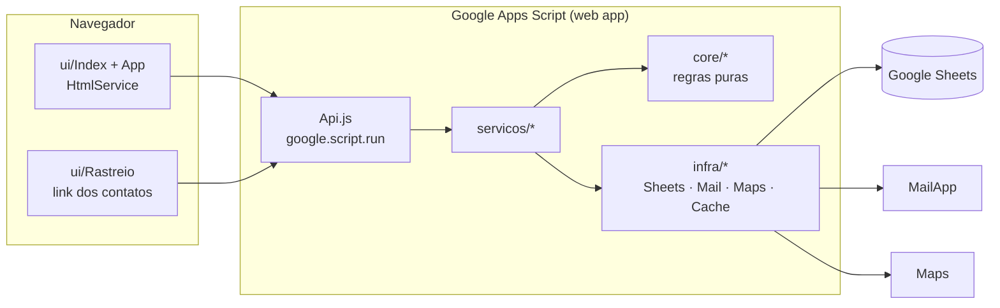

# Aurora — segurança e apoio à mulher

Protótipo acadêmico de uma plataforma que amplia os serviços da **Casa da Mulher de Salvador**: botão de pânico com localização em tempo real, rotas até locais oficiais de atendimento, agendamento psicossocial e orientação jurídica (NUDEM). Desenvolvido em **Google Apps Script**, com testes automatizados e pipeline de CI/CD no GitHub Actions.

> UC Gestão e Qualidade de Software · Avaliação A3 · UNIFACS · 2026
> Equipe: Tauan Santos Santana, Natasha Souza da Silva, Jessica Santos Silva, Alana Clei Sena Souza, Dalila Soares da Silva

> **Em perigo agora?** Ligue **190** (Polícia Militar) ou **180** (Central de Atendimento à Mulher). Este repositório é um protótipo e não presta atendimento.

O nome **Aurora** é neutro de propósito: se alguém pegar o celular da usuária, o nome do app não revela do que se trata.

## O que há neste repositório

| App | O que faz | Status |
|---|---|---|
| **Aurora** (`apps/aurora`) | RF01–RF08 do documento de requisitos | Protótipo funcional |
| **Aurora Abrigo** (`apps/abrigo`) | Rede de hospedagem solidária temporária para quem precisa sair de casa | Fase 1: cadastro de anfitriões e regras; o encaminhamento fica para a fase 2 |

### Requisitos implementados

| Requisito | Prioridade (A3) | Onde |
|---|---|---|
| RF01 Cadastro da usuária | Média | `ServicoUsuaria`, `Validacao` |
| RF02 Contatos de emergência | Alta | `ServicoContatos` |
| RF03 Botão de pânico | **Crítica** | `ServicoAlerta`, `Alerta`, `ui/App` (segurar 2 s) |
| RF04 Localização em tempo real | **Crítica** | `ServicoAlerta.atualizarLocalizacao`, `ui/Rastreio` |
| RF05 Rotas seguras | Alta | `ServicoPontos.rota`, `MapsGateway` |
| RF06 Pontos seguros próximos | Alta | `Geo.pontosProximos`, `DadosIniciais` |
| RF07 Agendamento psicossocial | Média | `ServicoAtendimento`, painel da equipe |
| RF08 Atendimento jurídico (NUDEM) | Média | `ServicoAtendimento`, `ServicoPontos.juridico` |

A matriz completa (requisito → caso de teste do A3 → teste automatizado) está em [docs/plano-de-testes.md](docs/plano-de-testes.md).

## Arquitetura



- **core/**: regras puras (validação, distância, máquinas de estado). Não usa nenhum serviço do Google, então roda no Node e é testada com Jest.
- **infra/**: o único lugar que chama os serviços do Google. Trocar e-mail por SMS, ou Sheets por um banco, significa reescrever só esta camada (RNF07).
- **shared/**: código comum aos dois apps. O `scripts/build.js` junta `shared/` com o app em `dist/<app>/`, que é o que o `clasp` envia.

Mais detalhes em [docs/arquitetura.md](docs/arquitetura.md).

## Rodando localmente

```bash
npm ci
npm run lint        # análise estática
npm test            # testes de unidade + integração (com fakes dos serviços do Google)
npm run test:ci     # com cobertura e quality gate
npm run build       # gera dist/aurora e dist/abrigo
```

Os testes não precisam de conta Google. Os serviços do Apps Script (SpreadsheetApp, MailApp, Maps…) são simulados em memória por `test/helpers/gasFakes.js`.

## CI/CD

```
PR/push ─► Qualidade: lint → unitários → integração + cobertura → build
                 │ (main)
                 ▼
             Staging: clasp push → deployment → smoke test (confere o commit publicado)
                 │
                 ▼
             Produção: aprovação manual → deploy → smoke test
Falha na main ─► issue de defeito automática (5 Porquês + 5W2H)
Diariamente   ─► regressão completa + smoke nos ambientes publicados
Ao abrir issue de defeito ─► prioridade pela Matriz GUT + categoria Ishikawa
Mensalmente   ─► Pareto de defeitos, taxa de escape e MTTR
```

Para configurar os projetos Apps Script e os segredos do GitHub, siga [docs/setup-google-e-ci.md](docs/setup-google-e-ci.md).
O fluxo de correção e a FMECA estão em [docs/manutencao-e-correcao.md](docs/manutencao-e-correcao.md).

## Privacidade e segurança (RNF01/RNF02)

- Senhas guardadas com hash SHA-256, salt e iterações. Nunca em texto puro.
- Bloqueio após 5 tentativas de login. A mesma mensagem de erro aparece para e-mail inexistente e para senha errada.
- O link de rastreio usa um token aleatório de 256 bits e mostra a posição **somente enquanto o alerta está ativo**. Ele expira em 12 h.
- O histórico de localização é apagado após 30 dias, por uma rotina automática.
- A usuária pode excluir a conta e todos os dados (LGPD, art. 18).
- Há um botão "Sair rápido" e a sessão fica em `sessionStorage`.
- **Nenhum dado real** deve entrar neste repositório, que é público: nem em issues, nem em testes ou prints.

## Licença

MIT. Projeto acadêmico, sem vínculo oficial com a Prefeitura de Salvador ou com a Casa da Mulher Brasileira.
