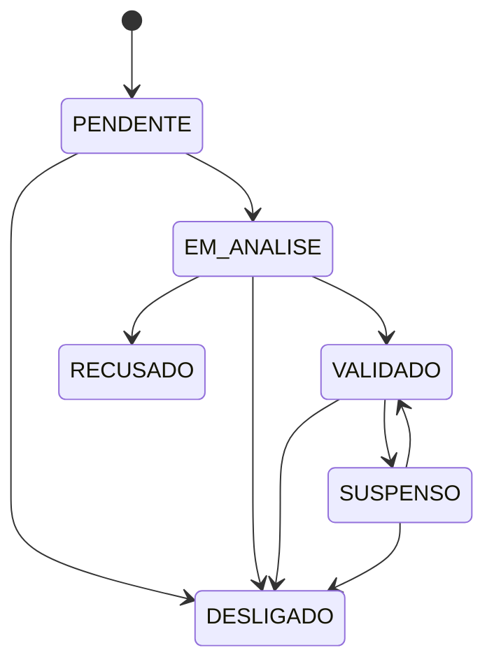

# Aurora Abrigo: rede de acolhimento solidário

## Problema

O maior obstáculo em caso de violência é ter um lugar seguro para ficar enquanto a mulher trata da medida protetiva, do boletim de ocorrência e do auxílio financeiro durante a separação. Esses trâmites são burocráticos e demorados, e a **reincidência** está ligada principalmente à **dependência financeira e de moradia**.

## Proposta

Um cadastro, junto à Casa da Mulher, de pessoas dispostas a oferecer hospedagem temporária. Funciona como uma rede solidária, de iniciativa privada, **validada por órgão público** para manter a segurança.

Quem hospeda informa:

- se recebe só a mulher ou também os filhos, e até quantos;
- por quanto tempo pode receber (até 90 dias);
- se a casa tem acessibilidade;
- e faz uma **capacitação** (sigilo, acolhimento sem julgamento, rede de proteção, direitos).

## Decisão de segurança: não é um "Airbnb" aberto

Se a usuária pudesse navegar por endereços, qualquer agressor com uma conta conseguiria mapear onde as mulheres se escondem. Por isso:

| Regra | Implementação |
|---|---|
| Endereço, nome e telefone de quem hospeda **nunca** aparecem em busca | `Anfitriao.visaoPublica` (testado: nenhum campo identificador sai) |
| Só entra na rede quem foi **validado** E **concluiu a capacitação** | `Anfitriao.disponivel` |
| O encaminhamento (*match*) é feito pela **equipe da Casa da Mulher** | `ServicoAnfitriao.buscarCompativeis` (uso interno) |
| Evitar o bairro onde está o agressor | `necessidade.evitarBairros` |
| E-mails para a equipe não levam endereço nem nome | `anfitriao.test.js › notifica a equipe` |
| Dados em projeto e planilha **separados** do Aurora | arquitetura |

## Fases

| Fase | Escopo | Status |
|---|---|---|
| 1 | Cadastro de anfitrião, termo de sigilo, consentimento, consulta de status por protocolo, regras de compatibilidade e estados | **Pronto (este repositório)** |
| 2 | Painel da equipe para análise e validação; registro da capacitação; busca de compatíveis integrada ao Aurora | Planejado |
| 3 | Acompanhamento da estadia, avaliação e desligamento; integração com auxílio financeiro | Ideia |

## Estados do cadastro

## Pontos para validar com a Casa da Mulher

- Que órgão faz a verificação de quem hospeda (antecedentes, visita)?
- Existe base legal ou convênio para hospedagem solidária? Quem responde em caso de incidente?
- A capacitação é presencial ou on-line? Quem certifica?
- Há algum apoio financeiro para quem hospeda?
