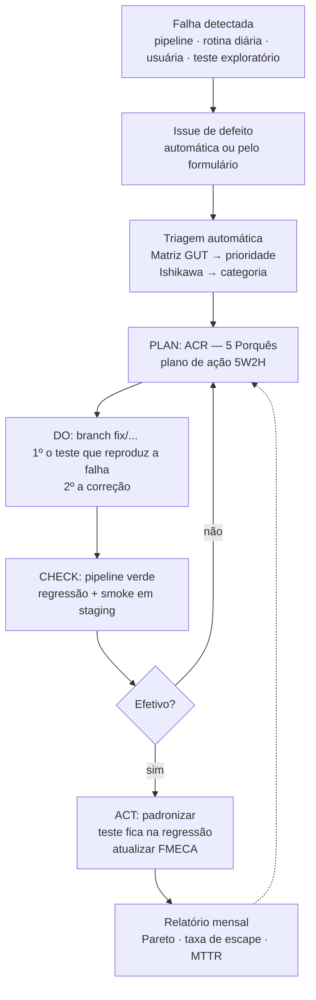

# Manutenção e correção

Aplica as ferramentas de **Planejamento e Controle da Manutenção** ao software: FMECA, Matriz GUT, Diagrama de Ishikawa, Análise de Causa Raiz (5 Porquês), 5W2H, Pareto e PDCA.

## 1. Tipos de manutenção no projeto

| Tipo | Como acontece aqui |
|---|---|
| **Corretiva** | Falha no pipeline ou na rotina diária abre issue de defeito; correção via PR com teste de confirmação |
| **Preventiva** | Rotina diária de regressão e smoke test; gatilho de hora em hora que expira alertas e apaga dados vencidos (`rotinaManutencao`) |
| **Preditiva** | Health check expõe a cota de e-mail restante e avisa quando ela zera; logs com `duracaoMs` de cada acionamento |
| **Adaptativa** | Dependabot atualiza dependências e actions; a camada `infra/` isola os serviços externos |
| **Evolutiva** | Issues de melhoria com critérios de aceitação; feature Aurora Abrigo em fases |

## 2. Fluxo de correção (PDCA)

Regras:

- Toda correção começa por um **teste que falha** e reproduz o defeito. Depois da correção ele passa e fica na regressão para sempre.
- A issue só fecha com as três caixas do formulário marcadas: teste de confirmação, regressão + smoke e avaliação de efetividade.
- Defeito `prioridade:critica` em RF03/RF04 **bloqueia** a liberação para produção.

### Matriz GUT (automática)

| G × U × T | Label | Exemplo |
|---|---|---|
| ≥ 80 | `prioridade:critica` | alerta de pânico não enviado (5 × 4 × 4) |
| 36–79 | `prioridade:alta` | rota mostra destino errado (4 × 3 × 3) |
| 12–35 | `prioridade:media` | filtro de pontos falhando (3 × 2 × 2) |
| < 12 | `prioridade:baixa` | texto desalinhado |

Implementação: `.github/workflows/triagem.yml` e `scripts/github/triagem-gut.js`.

### Ishikawa (6M adaptado ao software)

| Categoria | Exemplos neste projeto |
|---|---|
| Método | requisito ambíguo, regra de negócio errada |
| Máquina | cota do Apps Script, tempo de execução, deploy |
| Material | dados da planilha, pontos seguros desatualizados |
| Mão de obra | conhecimento, revisão que não pegou |
| Medição | teste ausente ou fraco, smoke insuficiente |
| Meio ambiente | GPS, navegador, Maps, entrega de e-mail |

## 3. FMECA do fluxo crítico (RF03/RF04)

Escala de 1 a 10 para S (severidade), O (ocorrência) e D (detecção, em que 10 = difícil de detectar). **NPR = S × O × D.**

| # | Modo de falha | Efeito | Causa provável | S | O | D | NPR | Mitigação implementada | Evidência (teste) |
|---|---|---|---|---|---|---|---|---|---|
| 1 | Agressor tem acesso ao celular | Descobre o app e o pedido de ajuda | Convivência | 9 | 5 | 7 | **315** | Nome neutro, botão "Sair rápido", sessão só na aba | — (residual: **próxima iteração** — modo disfarçado e PIN) |
| 2 | Link de rastreio repassado | Terceiros veem a localização | Encaminhamento do e-mail | 9 | 3 | 6 | 162 | Token de 256 bits; posição só enquanto ATIVO; expira em 12 h; só o primeiro nome; aviso "não encaminhe" | `alerta.test.js › rastreio` |
| 3 | GPS indisponível ou negado | Contatos sem localização | Permissão, ambiente fechado | 8 | 6 | 3 | 144 | Alerta sai sem GPS; link atualiza quando a posição chega; GPS "aquecido" na tela inicial | `alerta.test.js › sem GPS` |
| 4 | Cota de e-mail esgotada | Ninguém é avisado | Limite do Gmail (~100/dia) | 10 | 3 | 4 | 120 | Status FALHOU na tela com "Ligar 190"; health check avisa | `alerta.test.js › cota`, `api-e-main.test.js › cota` |
| 5 | Gravações concorrentes na planilha | Acionamento perdido | Muitos acessos simultâneos | 8 | 3 | 5 | 120 | LockService em toda escrita | `CT-SIS02` |
| 6 | E-mail falha para um contato | Contato não avisado | Endereço inválido, falha temporária | 9 | 4 | 3 | 108 | Nova tentativa; envio independente por contato; status PARCIAL | `alerta.test.js › PARCIAL / falha temporária` |
| 7 | Acionamento acidental | Alarme falso | Toque sem querer | 6 | 6 | 3 | 108 | Segurar 2 s com anel de progresso; encerrar avisa os contatos | CT-ACE02 (manual) |
| 8 | Sessão expirada na hora do pânico | Alerta não é aceito | Token vencido | 9 | 3 | 4 | 108 | Expiração deslizante (uso renova 6 h); tela de falha com "Ligar 190" | `usuaria.test.js › expiração deslizante` (residual: app parado por mais de 6 h) |
| 9 | Sem conexão | Alerta não chega ao servidor | Rede móvel | 10 | 5 | 2 | 100 | 3 tentativas com espera crescente; botão "Ligar 190" | Teste exploratório |
| 10 | Planilha ou Apps Script indisponível | Erro no servidor | Instabilidade do Google | 10 | 2 | 3 | 60 | Mensagem de erro orienta 190; smoke diário detecta | `api-e-main.test.js › health` |
| 11 | Toque duplo | Alertas e e-mails duplicados | Usuária nervosa | 4 | 7 | 2 | 56 | Acionamento idempotente enquanto ATIVO | `alerta.test.js › idempotência` |

**Pareto da FMECA**: os itens 1 a 4 concentram mais da metade do NPR total. O item 1 é o principal risco residual e é a primeira melhoria proposta para a próxima entrega.

## 4. Plano de ação (5W2H) para o risco residual nº 1

| O quê | Por quê | Onde | Quando | Quem | Como | Quanto |
|---|---|---|---|---|---|---|
| Modo disfarçado + PIN de acesso | NPR 315: o agressor pode descobrir o app | `apps/aurora/ui` | Próxima sprint | Equipe front + QA | Tela inicial neutra (ex.: "Lista de compras"); o pânico abre por gesto; PIN para ver contatos e histórico | Sem custo (Apps Script) |
| Canal de alerta por SMS/WhatsApp | Reduz a dependência da cota de e-mail (item 4) | `infra/EmailGateway` → novo gateway | Após validar o protótipo | Equipe back | Gateway com API paga, atrás da mesma interface `enviar()` | Custo por mensagem |
